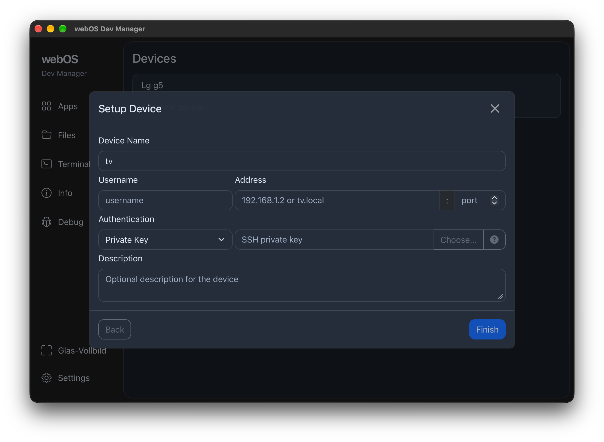
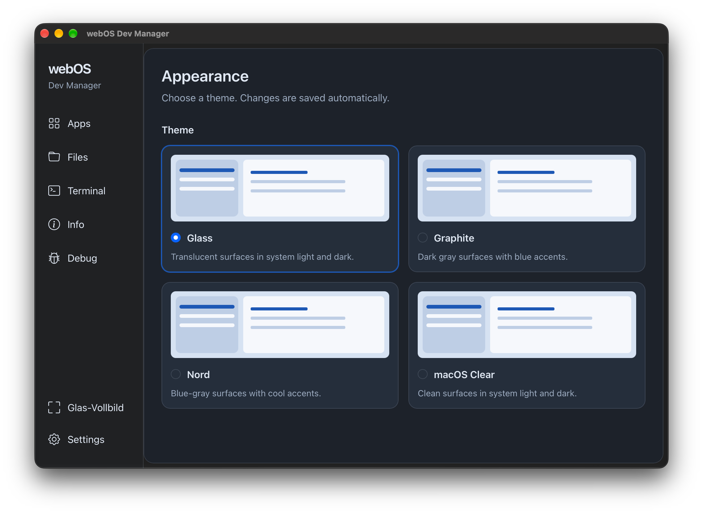
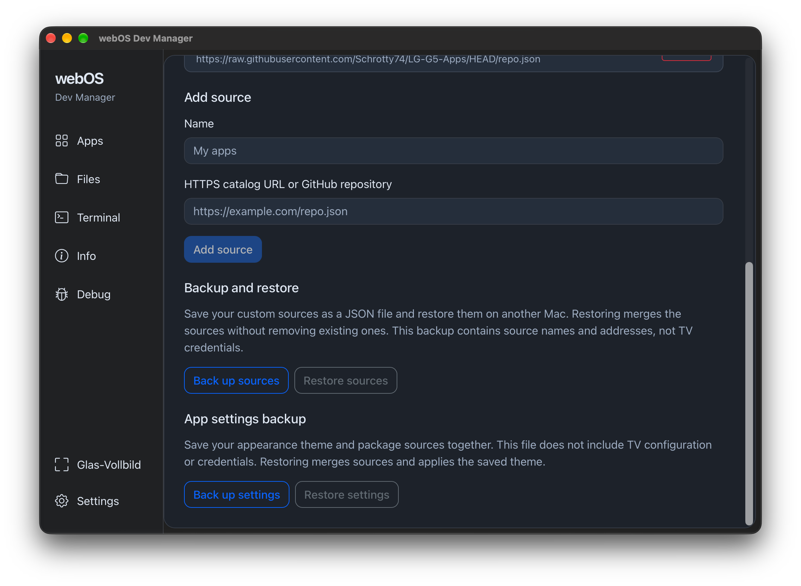
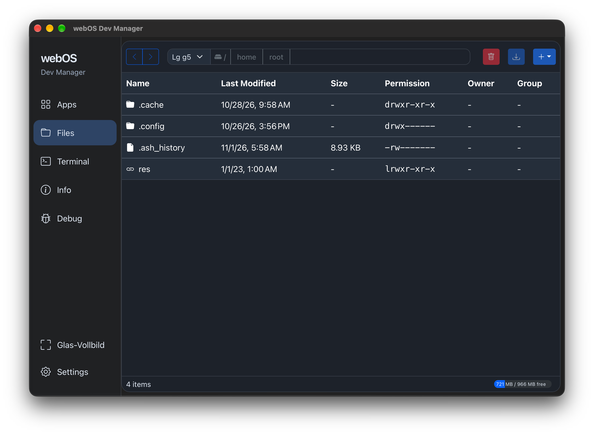
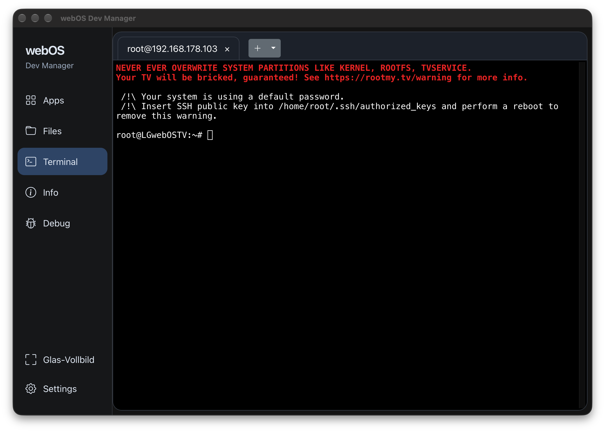
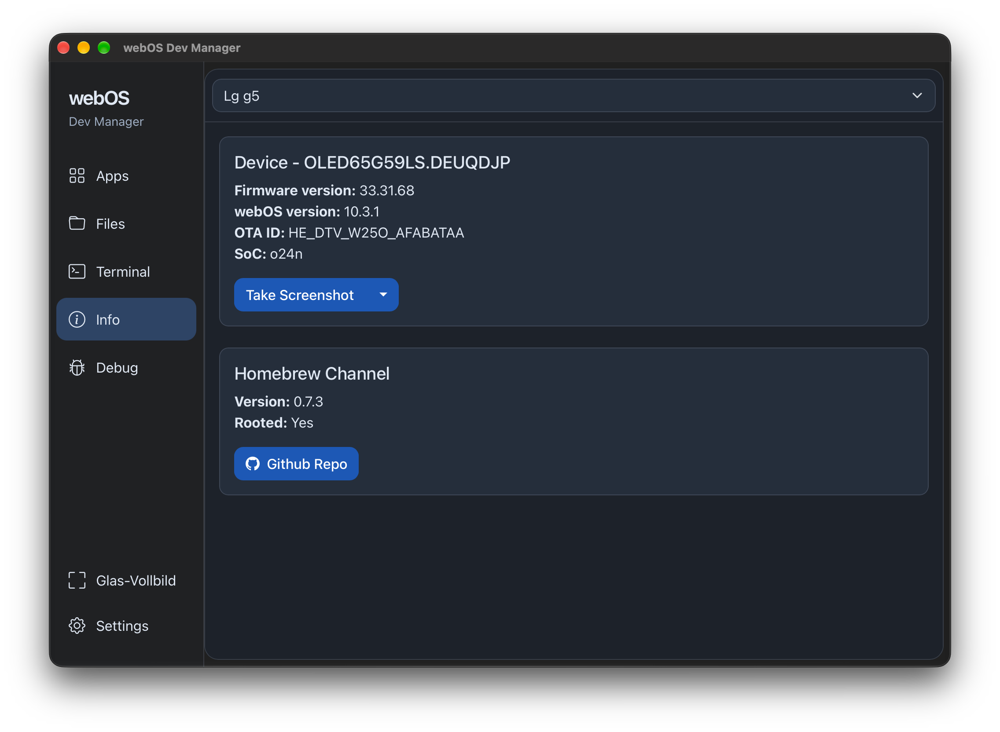
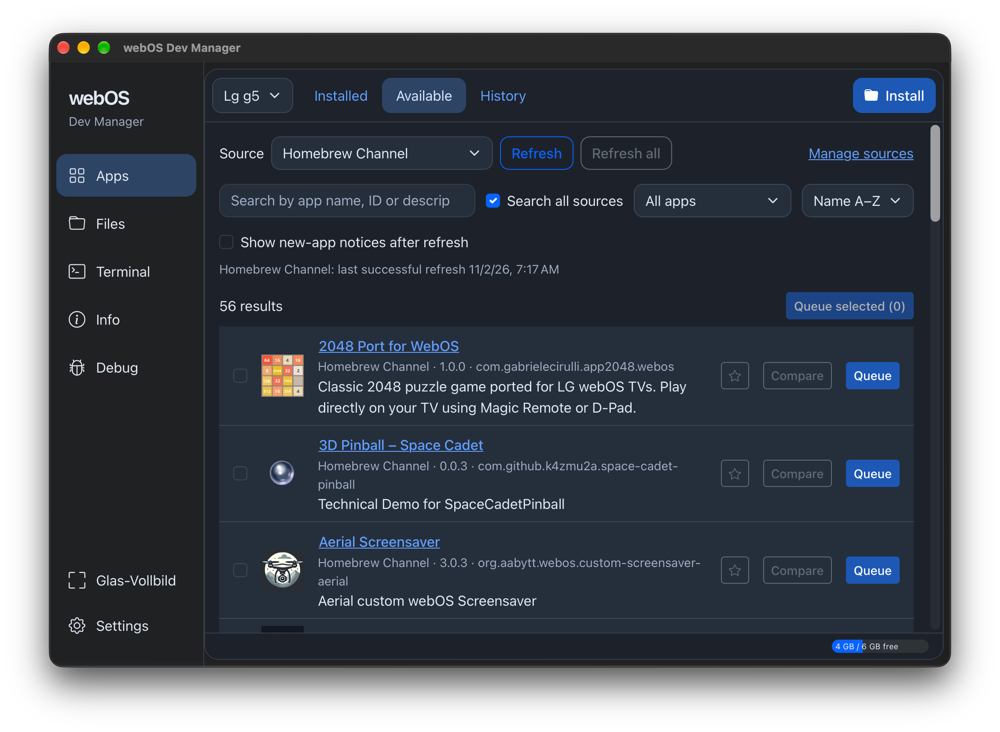

# webOS Dev Manager

Manage developer mode and apps on webOS TVs from macOS. This is the [Schrotty74 fork](https://github.com/Schrotty74/dev-manager-desktop) of [webOS Dev Manager](https://github.com/webosbrew/dev-manager-desktop).

## Download

See the [latest fork release](https://github.com/Schrotty74/dev-manager-desktop/releases/latest) or download the Apple Silicon disk image for [version 1.99.24](https://github.com/Schrotty74/dev-manager-desktop/releases/tag/v1.99.24):

[`webOS-Dev-Manager_1.99.24_arm64.dmg`](https://github.com/Schrotty74/dev-manager-desktop/releases/download/v1.99.24/webOS-Dev-Manager_1.99.24_arm64.dmg)

This build is for Apple Silicon Macs. It is ad-hoc signed and not notarized by Apple. macOS may require approval to open it; see [Apple's instructions](https://support.apple.com/en-us/102445).

## Features

### Apps and package sources

- Install local IPK files or apps from Homebrew Channel and custom JSON catalogs. Launch, update, and uninstall apps; install beta packages when a catalog provides them.
- Add and remove custom sources using HTTPS catalog addresses or supported GitHub repository URLs. Homebrew Channel remains the protected default source.
- Search app names, IDs, and descriptions across one or all sources, including paginated catalogs.
- Filter by installed, not installed, updates available, favorites, or new apps. Sort names A–Z or Z–A.
- Refresh one source or all sources and see the last successful refresh time. Cached results remain visible if a source fails, with an error and retry control.
- Mark newly added apps after the first successful catalog check and optionally show in-app notices after refreshing. Mark new entries as seen.
- Compare an app's source, version, and package address before choosing where to install it from.
- Check installed apps for updates from custom sources as well as Homebrew Channel, and review each available source.
- Save favorites by app ID across sources.
- Queue multiple apps for sequential installation. Each item keeps its chosen source and target TV; pending items can be removed or canceled. Compatibility checks remain in place.
- View the last 100 installation results under History, with success or failure, target TV, time, and available app metadata. New installations and updates are recorded; existing apps are not imported retrospectively.
- Validate custom catalog manifests and HTTPS package addresses, require SHA-256 package hashes, and report how many invalid entries were skipped.

### TV management, files, and SSH

- Manage multiple developer-mode or rooted TVs without installing the LG SDK.
- Open SSH terminal sessions in multiple tabs.
- Browse TV files, upload, download, and delete files, create folders, and view file metadata and storage usage.
- Inspect model, firmware, webOS version, SoC, and Homebrew Channel information. Capture TV screenshots with root access.
- Read crash reports and, where TV permissions allow, system logs, kernel messages, and Luna service activity.
- Display Developer Mode time remaining, warn throughout the app during the final 24 hours, renew the session, and generate a script for scheduled renewal.

### Backup and restore

- Export and restore custom package sources as a portable JSON backup, including the last selected individual catalog.
- Back up the appearance theme and package sources together. Restore validates the backup, merges sources, and skips duplicate addresses.
- Keep TV credentials and device configuration out of source and settings backups.

### macOS appearance

- Choose Glass, Graphite, Nord, or macOS Clear, with a saved theme selection. Glass and macOS Clear follow the system light/dark preference; Graphite and Nord use dark palettes.
- Use native Liquid Glass window effects on macOS 26 and later, with native sidebar material as a fallback on older macOS versions.
- Enter Glass fullscreen on the current desktop through the sidebar, Window menu, or `Control+Command+Shift+F`. Press Escape to leave it after any open dialog or menu has handled the key. Standard macOS fullscreen remains available.
- Build and package this fork for macOS on Apple Silicon.

Under **Apps > Available**, choose **All sources** or one catalog. Enable **Search all sources** to search across catalogs. **Refresh** reloads the current scope; **Refresh all** reloads every configured source. New-app notices appear after a refresh, and the first successful load establishes the baseline.

Manage sources and JSON backups under **Settings > Package sources** (also accessible through **More** in compact layouts). Source-only backups remain supported. Settings backups include the theme and sources; they exclude TV credentials and configuration. **Apps > History** records new installation attempts and updates, without importing previously installed apps.

See the [macOS build instructions](src-tauri/README.md) and [changelog](CHANGELOG.md).

## Screenshots

Click a preview to view the full-size screenshot.

  
  
  
  
  
  
  

## Scheduled Developer Mode renewal

The generated renewal script requires `curl`, `jq`, and OpenSSH (`ssh` and `ssh-keygen`) on the machine that runs it. Install these with that system's package manager before scheduling the script. The script keeps a token cache for periods when the TV is unreachable and exits with an error if renewal fails.

## License

This project is licensed under the [Apache License 2.0](LICENSE). The fork builds on [webOS Dev Manager by the webOS Homebrew Team](https://github.com/webosbrew/dev-manager-desktop).
